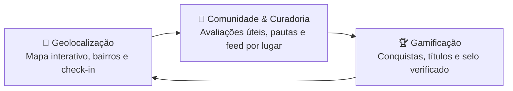

# 🎯 01. Visão do Produto

> [← Voltar ao Índice da Wiki](./00-home.md)

## O Problema

Grandes plataformas de mapas priorizam quem anuncia ou já tem alto volume de buscas. Em cidades de médio/grande porte como **Sorocaba**, isso faz com que cafeterias independentes, praças de bairro, feiras locais e centros culturais fiquem invisíveis para quem mora na própria cidade, enquanto avaliações genéricas se misturam sem contexto local.

## A Proposta do Soromaps

O **Soromaps** é um guia vivo de Sorocaba construído pela própria comunidade de moradores. A tese central do produto é simples: **o centro da experiência é o lugar**, e toda reputação dentro da plataforma nasce de ter efetivamente visitado e contribuído com lugares reais da cidade.

---

## Os Três Pilares

1. **Geolocalização Contextual:**
   - Mapa interativo de Sorocaba com filtros por categoria e bairro.
   - Dicas práticas que só quem frequenta sabe: *melhor horário para ir* e *segredo local* (o que pedir, onde sentar).
   - Check-in presencial validado por proximidade geográfica.
2. **Comunidade Centrada em Lugares (Sem Grafo Social):**
   - Não existe "seguir pessoas" nem disputa por seguidores.
   - O feed mostra o que está acontecendo na cidade a partir do vínculo do usuário com **bairros**, **categorias** e **lugares salvos**.
   - As avaliações são ordenadas pelo quanto ajudaram outros moradores (**voto de "Útil"**), não por curtidas de popularidade.
3. **Gamificação sem Inflação de Pontos:**
   - Em vez de barras de XP arbitrárias, o progresso é medido por **conquistas reais** (ex.: visitar 5 cafeterias diferentes, explorar 3 bairros novos, ter o primeiro ponto aprovado).
   - O título do explorador (*Novato*, *Explorador*, *Guia Local*, *Veterano*) e o selo de **Explorador Verificado** refletem diretamente esse histórico.

---

## Perfis de Uso

| Papel | Quem é | O que faz no Soromaps |
|---|---|---|
| **Visitante** |Qualquer pessoa acessando sem conta | Navega pelo mapa, descobre lugares em `/discover`, lê avaliações, consulta rankings da comunidade e lê pautas editoriais. |
| **Explorador** | Morador cadastrado na plataforma | Faz check-in nos locais visitados, salva favoritos, escreve avaliações e comentários, sugere novos pontos na cidade, desbloqueia conquistas e personaliza seu feed. |
| **Administrador / Moderador** | Curador da plataforma | Revisa e aprova sugestões de novos locais, gerencia o catálogo de categorias e conquistas, analisa denúncias e publica pautas editoriais. |

---

## O Que Ficou Fora de Escopo (Por Decisão de Produto)

Para manter o produto enxuto, útil e focado na descoberta urbana, três elementos comuns em redes sociais foram deliberadamente descartados:

- **Sem "Seguir Usuário" (`Segue`):** Seguir pessoas cria o problema do *feed vazio* para novos usuários e desloca o foco do lugar para a autopromoção. O feed do Soromaps é movido por bairros, categorias e lugares salvos.
- **Sem Painel de Dono de Estabelecimento (`business/*`):** O cadastro e reivindicação jurídica de comércios (CNPJ, disputa de propriedade) adiciona burocracia sem melhorar a descoberta para o morador. Qualquer explorador pode sugerir um ponto e a curadoria valida.
- **Sem XP Numérico:** Títulos e reputação derivam diretamente da quantidade de conquistas desbloqueadas e da régua pública de verificação.
