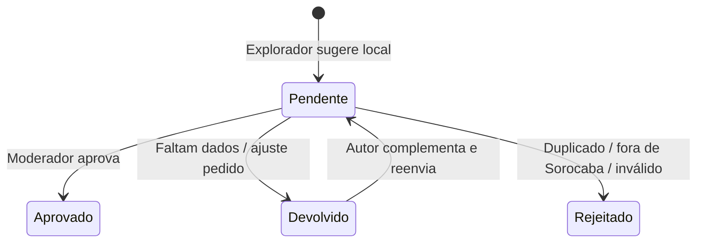

# 🛡️ 03. Moderação e Governança

> [← Voltar ao Índice da Wiki](./00-home.md)

Como o catálogo do Soromaps é colaborativo, a plataforma conta com fluxos claros de governança para evitar pontos falsos, duplicados ou avaliações abusivas sem engessar a participação da comunidade.

---

## 1. Ciclo de Vida de um Local

- **Pendente (`pending`):** Visível apenas para o próprio autor e para os moderadores.
- **Aprovado (`approved`):** Passa a aparecer publicamente no mapa (`/home`), na descoberta (`/discover`) e nas buscas, contando também para as conquistas de criação de ponto do autor.
- **Devolvido (`returned`):** Quando o local é legítimo mas precisa de complemento (ex.: descrição vaga ou pino levemente deslocado). O moderador informa o motivo e uma observação; o autor pode editar e reenviar.
- **Rejeitado (`rejected`):** Ponto inexistente, spam ou duplicata de outro já cadastrado.
- Toda decisão fica registrada em histórico com autor da decisão, data e motivo, permitindo reversão em até 24 horas caso o moderador tenha clicado por engano.

---

## 2. Moderação de Avaliações e Denúncias

Em vez de exigir aprovação prévia para cada avaliação ou comentário (o que travaria a conversa na plataforma), avaliações entram no ar imediatamente e passam por **moderação reativa e assistida por sinais**:

- **Denúncias Agrupadas (`/admin/reports`):** Quando vários usuários denunciam o mesmo local, avaliação ou comentário, o painel agrupa todas as denúncias por item-alvo e ordena pelos casos com maior número de denunciantes distintos.
- **Sinais Automáticos (`/admin/reviews`):** O painel destaca avaliações que merecem atenção mesmo antes de serem denunciadas:
  - *Nota destoante (Outlier):* Avaliação que diverge drasticamente da média histórica consolidada do local;
  - *Rajada (Burst):* Volume atípico de avaliações recém-criadas para o mesmo estabelecimento em poucas horas;
  - *Denunciada:* Avaliação com reporte aberto.
- **Remoção Unificada e Auditada:** Tanto pela tela de avaliações quanto pela de denúncias, remover um conteúdo exige escolher um motivo padronizado, congela uma cópia do texto original para auditoria e contabiliza a remoção no histórico do autor (impactando o selo de Explorador Verificado).

---

## 3. Áreas do Painel Administrativo (`/admin/*`)

| Tela | Papel na Operação |
|---|---|
| **Dashboard (`/admin/dashboard`)** | Visão executiva com filas de atenção imediata (pontos parados há > 48h, denúncias abertas), métricas de crescimento e gráficos de atividade diária. |
| **Moderação de Pontos (`/admin/moderation`)** | Tela mestre-detalhe para aprovar, devolver ou rejeitar locais sugeridos, com verificação de proximidade para evitar duplicatas. |
| **Categorias (`/admin/categories`)** | Gestão do catálogo de categorias (nome, ícone, cor do pino, ordem de exibição e reatribuição segura de pontos ao excluir uma categoria). |
| **Conquistas (`/admin/achievements`)** | Configuração do catálogo de medalhas, regras de desbloqueio e estimativa de quantos exploradores já cumprem cada critério. |
| **Avaliações (`/admin/reviews`)** | Auditoria de avaliações publicadas na plataforma com filtros por sinais automáticos. |
| **Denúncias (`/admin/reports`)** | Fila de triagem de conteúdos reportados pela comunidade (manter conteúdo ou remover com justificativa). |
| **Usuários (`/admin/users`)** | Listagem, busca, criação, edição de perfil/papel (`explorer` vs. `admin`) e exclusão de contas. |
