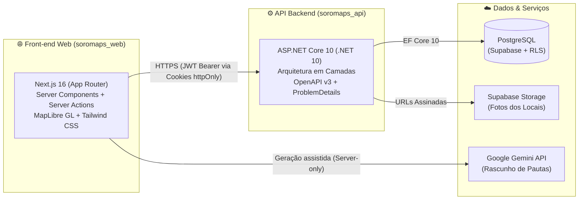

# 🏗️ 05. Ecossistema e Arquitetura Geral

> [← Voltar ao Índice da Wiki](./00-home.md)

O ecossistema do **Soromaps** é dividido em dois repositórios independentes que se comunicam via contrato HTTP/OpenAPI bem definido.

---

## Visão Geral do Ecossistema

---

## Papéis de Cada Repositório

### 1. Front-end Web (`soromaps_web` — este repositório)
- **Responsabilidade:** Experiência do usuário, renderização do mapa interativo (`MapLibre GL`), páginas públicas e autenticadas, gerenciamento de sessão segura em cookies `httpOnly`, validação de formulários e assistência editorial com IA (`Gemini`).
- **Hospedagem:** Vercel.
- **Documentação local:**
  - [`docs/wiki/`](./00-home.md): Visão geral do projeto e regras do produto (esta Wiki);
  - [`docs/adr/`](../adr/README.md): Decisões arquiteturais e de interface do front-end;
  - [`docs/todo/`](../todo/README.md): Roteiro de integração dos módulos do front-end com a API.

### 2. Backend API (`soromaps_api` — repositório irmão)
- **Responsabilidade:** Regras de negócio, autenticação e rotação de sessões (JWT + Refresh Token), persistência no PostgreSQL via Entity Framework Core, políticas de autorização (`Explorer` vs. `Admin`), geração do contrato OpenAPI (`/openapi/v1.json`) e padronização de erros (`ProblemDetails`).
- **Hospedagem:** Azure App Service + banco PostgreSQL gerenciado no Supabase.
- **Documentação no repositório da API (`../soromaps_api/Docs/`):**
  - `Docs/ArchitectureDecisionRecords/`: ADRs técnicos da API (fundação, autenticação/sessões e arquitetura em camadas);
  - `Docs/Diagrams/Dbml/Schema.dbml`: Modelagem relacional atualizada do banco de dados;
  - `Docs/Todo/Api/`: Pendências técnicas de expansão da API para atender todos os módulos do produto.
